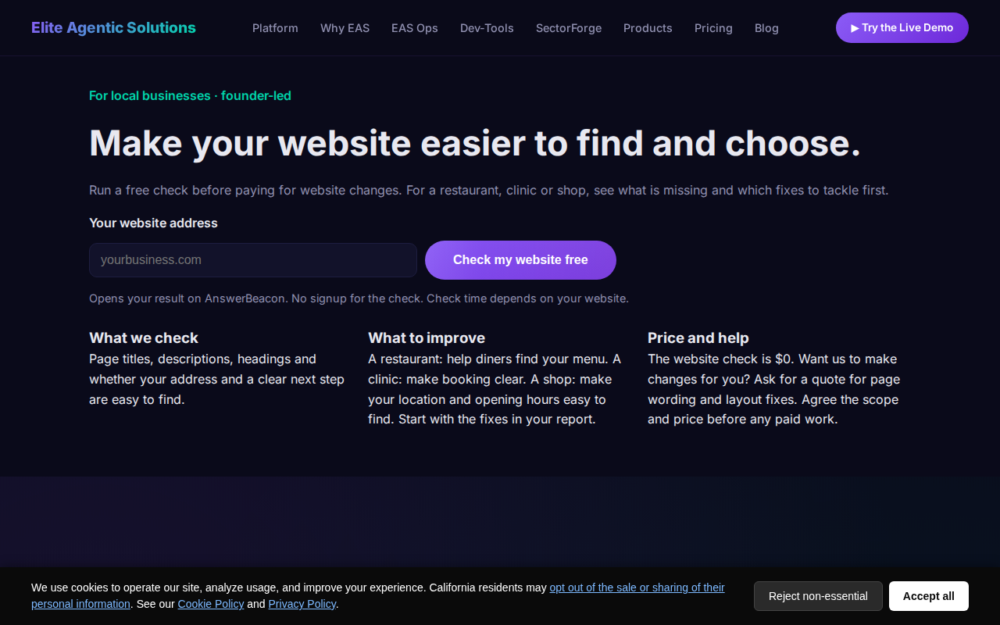

# Elite Agentic Solutions: site

Static marketing site for [Elite Agentic Solutions](https://eliteagenticsolutions.com), generated by one Python script. No framework and no build toolchain beyond Python 3.

[](https://eliteagenticsolutions.com)

*Screenshot of the live site. The generator in this repo produced an earlier version of it.*

**Live demo:** https://eliteagenticsolutions.com

## What it does

- `build_site.py` writes the pages, the blog index, the comparison pages and `sitemap.xml`.
- `build_aml_toolkit_pdf.py` builds the downloadable AML toolkit PDF into `downloads/`.
- `_headers`, `_redirects` and `CNAME` hold the static-host config.

## Stack

Python 3 (standard library), plain HTML, CSS and JS, deployed to a static host.

## Run it

```bash
git clone https://github.com/Hulkmode85/elite-agentic-solutions-site
cd elite-agentic-solutions-site
python3 build_site.py
python3 build_aml_toolkit_pdf.py   # optional: regenerate the PDF
python3 -m http.server 8000        # open http://localhost:8000
```

## License

No license file is included yet, so all rights are reserved. Ask before reusing the content.
